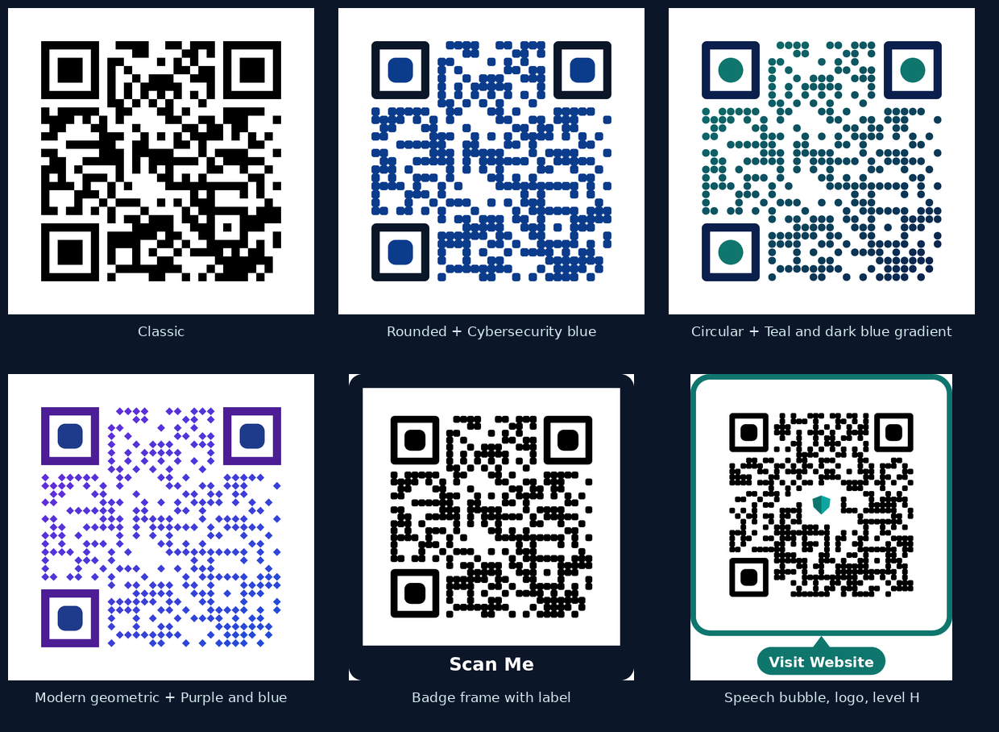

# 🛡️ CyberShield AI

**Intelligent Security. Clear Insights. Safer Digital Experiences.**

An educational cybersecurity toolkit built with Python and Streamlit: inspect suspicious URLs, hash files, create and inspect QR codes, and learn the basics, with optional VirusTotal lookups and an AI guide (CyberGuide AI) powered by OpenRouter.

> Educational tool. It does not guarantee safety. Zero detections or "no heuristic signals" never prove that something is safe.

**Contents:** [What works today](#what-works-today) · [QR Code Generator](#qr-code-generator) · [Security and privacy](#security-and-privacy) · [Configuration](#configuration) · [Run locally](#run-locally) · [Deploy](#deploy-to-github-and-streamlit-community-cloud) · [Project layout](#project-layout) · [Testing status](#testing-status-what-was-and-was-not-verified) · [Known limitations](#known-limitations)


Live At : https://cybershield-ai-intelligent-cybersecurity-toolkit.streamlit.app/


## What works today

A visitor first lands on a landing page (hero, features, how it works, about, footer). **Get Started** enters the app on the Overview Dashboard, where a 🛡️ shield button (top-left, with a subtle ripple animation that switches off for users who prefer reduced motion) opens the navigation sidebar and CyberGuide AI is available. The landing page itself shows neither. The sidebar lists all eight pages, highlights the current one, and closes when you choose a page; it starts closed. State is per browser session, so a refresh returns to the landing page.

| Module | What it does | Needs an API key? |
|---|---|---|
| Overview Dashboard | Service status, tool list | No |
| URL Security Scanner | Offline URL heuristics (never visits the link), defanged display, optional VirusTotal lookup, optional AI explanation | Optional |
| File Hash Analyzer | Local SHA-256/SHA-1/MD5, compare with a known hash, optional VirusTotal hash lookup | Optional |
| QR Code Generator | 17 content types (URL, text, email, phone, SMS, Wi-Fi, WhatsApp, vCard, social profiles, hosted-file links, Google Drive links, calendar events); module and marker shapes; presets, colors, gradients, transparency; logo; frames and labels; error correction, quiet zone, size; PNG/JPG/TIFF/SVG/PDF; read-back check | No |
| QR Code Security Analyzer | Decodes an uploaded QR image locally, shows content as text, runs URL heuristics, optional VirusTotal lookup | Optional |
| Security Learning Center | Short static lessons | No |
| Settings & API Configuration | Shows whether keys are detected, how to set them | No |
| About | Data sharing table, limitations | No |
| **CyberGuide AI** (floating chat, every page) | Explains the app from `knowledge.md`; AI answers via OpenRouter, documentation fallback without it | Optional |

**Planned, not implemented:** AI Security Assistant (full page), Phishing Awareness Lab, Security Reports, uploads above 25 MB to VirusTotal. **Deliberately not offered in the QR generator:** EPS export and background images (see [QR Code Generator](#qr-code-generator)).

Opt-in VirusTotal submission is available, never automatic: the URL Security Scanner can request a new URL analysis, and the File Hash Analyzer can upload a file (up to 25 MB, original file name withheld) for a new analysis. Both require reading the privacy notes and ticking a per-item confirmation box. Uploaded files are shared with VirusTotal's security community, so do not upload confidential files. The app never visits URLs and never executes files.

## QR Code Generator

Everything runs locally. The preview, the read-back check and every download are drawn from **one shared description of the image**, so what you see is what you download. Nothing is sent to any service and no link you enter is ever opened.



*Example outputs of the generator's renderers, each read back successfully by the built-in decoder. These are generated images, not screenshots of the app's interface.*

### Using it

1. Pick a **Category** and **Content type**, then fill in the fields. The exact text that will be encoded is shown (Wi-Fi passwords are masked on screen).
2. Check the **Preview** and the read-back message under it.
3. Optionally open the setting groups: *Design & Appearance*, *Colors & Gradients*, *Logo & Branding*, *Frames & CTA*, *Technical Settings*.
4. Choose a format under **Export & Download** and press download. Test-scan the file with a phone before sharing it.

### Content types

| Category | Types | Notes |
|---|---|---|
| Basic | URL, Text, Email (optional subject and message), Phone call, SMS | URLs must be `http://` or `https://`; credentials in a URL are refused |
| Contact & communication | Wi-Fi, WhatsApp chat link, Contact card (vCard) | Wi-Fi and vCard values are escaped for their formats |
| Social & business | Instagram, Facebook, YouTube, LinkedIn, other social profile URL, Business contact (vCard) | A username or a link on the right site; look-alike domains are refused |
| Files & documents | Link to a hosted file (PDF, Word, Excel, PowerPoint, text, CSV, ZIP, Python, other documents), Google Drive share link | **The code holds a link, not the file.** The app does not host files. Programs and scripts (`.exe`, `.bat`, `.sh`, `.js`...) are refused |
| Calendar | Event (title, location, start, end, all-day, UTC option, description) | iCalendar with escaping and line folding; the same input always gives the same code |

### Customization

| Group | Options |
|---|---|
| Design & Appearance | Module shape: square, rounded, circular dots, diamonds. Position markers: outer (square, slightly rounded, circular ring *decorative and unverified*) and inner (square, rounded, circle). Presets: Classic, Rounded, Circular, Modern geometric |
| Colors & Gradients | Presets (Classic black and white, Cybersecurity blue, Cyan and navy, Teal and dark blue, Purple and blue, Navy on white, Teal on white), custom colors by picker or hex value, solid / linear / diagonal / radial gradient, separate marker colors, background color, transparent background |
| Logo & Branding | PNG or JPG up to 1 MB (checked by file content), size 5% to 22% of the width (default 12%), clear space 0 to 3 modules, always centred |
| Frames & CTA | Simple border, rounded rectangle, badge, tag, speech bubble. Label presets (Scan Me, Visit Website, View Menu, Contact Us, Follow Us) or custom text up to 30 characters; size, bold, frame color, padding, automatic readable label color |
| Technical Settings | Error correction L, M, Q, H (about 7, 15, 25, 30% recoverable, **not a guarantee**); quiet zone 1 to 10 modules (default 4); output size 512, 768, 1024, 2048, 4096 px |

Frames and labels are placed outside the code and its quiet zone, so they never cover it.

### Export formats

| Format | Kind | Transparent | Notes |
|---|---|---|---|
| PNG | Raster | Yes | Sharp, lossless |
| JPG | Raster | No | Transparent designs are filled with the background color (the page says so) |
| TIFF | Raster | Yes | Lossless, LZW compressed |
| SVG | Vector | Yes | Stays sharp at any size. A logo is an embedded bitmap; the label is live text |
| PDF | Vector | Yes | Page size equals the PNG at 300 dpi; the label uses the built-in Helvetica font; a logo is an embedded bitmap |
| HTML embed code | Snippet | n/a | An `` tag with the SVG inlined as a data URI; alt text is escaped |

Raster files at 4096 px are only built when you press *Prepare*, to keep memory use low. **Not offered:** EPS (no way to validate an EPS file here, and the image library only writes bitmap EPS) and background images (they cannot be made reliably scannable). Use SVG or PDF for print-oriented vector files.

### Reliability: how scannability is checked

After every change the app **samples every module of the finished picture** (proving the styling kept the data pattern) and then **decodes the picture** with OpenCV, reporting one of: read back exactly, could not be read, read back as different content, or decoder unavailable. This is evidence from one decoder, not a guarantee for every phone.

What testing showed, and how it shaped the design:

- Rounded, dotted and diamond **data modules** decoded reliably.
- A strongly rounded or **circular outer position marker** was not readable by the decoder (a gentle corner radius of 0.7 modules or less was; 0.8 began to fail; the old 2.0 radius mostly failed). The "slightly rounded" marker is therefore capped at 0.6, and a circular ring is offered only as a clearly labelled, unverified option. Presets never use it.
- Every style preset combined with every color preset decoded in development sweeps; the test suite re-checks these combinations.
- If a design cannot be read back, the page warns and offers one click to return to the most reliable style and colors.
- A logo that would cover a position marker, timing pattern or format information is refused; covering an alignment pattern produces a warning. Levels L/M with a logo are discouraged, and level H is applied automatically unless you untick it.

## Security and privacy

- **Local only.** QR generation, rendering, the read-back check and downloads send nothing anywhere. The generator contains no network client, and tests assert that building payloads and pages makes no network connection.
- **Links are never opened or fetched.** They are only checked for syntax.
- **Structured formats are escaped**, not concatenated: vCard, iCalendar, Wi-Fi, mailto, WhatsApp and URLs. Fields with line breaks that could inject extra vCard or calendar properties are refused.
- **Logo uploads are judged by content** (real PNG or JPEG, verified, size and dimension limits), re-encoded when embedded, and never executed.
- **SVG and PDF output is inert**: no scripts, no external references, no JavaScript or launch actions; SVG text is XML-escaped and PDF strings are escaped.
- Wi-Fi passwords are masked in the on-screen payload preview. The QR code itself still contains the password, so treat it like the password.
- The rest of the app's data-sharing rules (VirusTotal and OpenRouter only when you press a button and, for uploads, confirm) are in **About** and `docs/security.md`.

## Configuration

| Name | Required? | Default |
|---|---|---|
| `OPENROUTER_API_KEY` | For AI answers only | none |
| `OPENROUTER_MODEL` | No | `openai/gpt-4o-mini` |
| `OPENROUTER_BASE_URL` | No | `https://openrouter.ai/api/v1` |
| `VIRUSTOTAL_API_KEY` | For VirusTotal lookups and opt-in URL submission | none |
| `APP_ENV` | No | `development` (set `production` to hide error details) |

The app starts and all local tools work with none of these set.

## Run locally

```bash
python -m venv .venv
source .venv/bin/activate          # Windows: .venv\Scripts\activate
pip install -r requirements.txt
cp .env.example .env               # optional; add keys if you have them
streamlit run streamlit_app.py
```

Run the tests:

```bash
python -m unittest discover -s tests -t . -v     # no extra tools needed
python -m pytest                                  # also works (pytest is in requirements.txt)
```

## Deploy to GitHub and Streamlit Community Cloud

1. Confirm `.env` and `.streamlit/secrets.toml` are **not** tracked (`git status`). They are in `.gitignore`.
2. `git init && git add . && git commit -m "CyberShield AI" ` then create a GitHub repo and push.
3. On Streamlit Community Cloud choose **Create app**, select the repo and branch, and set the main file to `streamlit_app.py`.
4. Open **Advanced settings → Secrets** and paste (only the keys you have):
   ```toml
   OPENROUTER_API_KEY = "..."
   VIRUSTOTAL_API_KEY = "..."
   APP_ENV = "production"
   ```
5. Deploy. After changing secrets later, reboot the app.

Preparing these files is not the same as deploying: this project has **not** been deployed or opened on Streamlit Community Cloud by its author tooling. Open your live URL and try each page before sharing it.

## Project layout

```
streamlit_app.py     entry point, router
app_registry.py      single source of truth for modules (navigation sidebar, dashboard, chatbot, tests)
config.py            secure config (env vars, then Streamlit secrets)
knowledge.md         CyberGuide AI's documentation (retrieved by section)
views/               one render() per page
components/          theme, navigation (shield drawer: shield_nav, nav_state, shield_nav_css; legacy sidebar), chrome CSS, landing page (landing, landing_css, app_state), cards, VirusTotal report UI, floating chat, Streamlit compat helper
backend/             url_analyzer, file_hashing, virustotal_client, openrouter_client, ai_explainer, security_utils
qr_tools/            generator (matrix via qrcode, original renderer), decoder (OpenCV); QR generator: payloads (content types), design, geometry, scene, render_raster / render_svg / render_pdf, exporter
cyberguide/          knowledge_base (retrieval), engine (answer logic)
content/             learning-center text, landing-page copy
tests/               unit tests (unittest-style; pytest-compatible); tests/qr_matrix.py supplies a real QR matrix from OpenCV for rendering tests
docs/                architecture, setup, deployment, security, original project spec; docs/images/ holds the README example image
```

`views/` is deliberately not named `pages/`: Streamlit auto-creates extra routes for a `pages/` folder.

## Testing status (what was and was not verified)

Last run in the development sandbox: **531 tests, all passed, 5 skipped** (`python -m unittest discover -s tests -t .`, a few minutes, because the QR reliability tests decode hundreds of rendered images).

- Covered: URL heuristics, hashing against known vectors, payload builders, rendering/export, QR decoding (fixtures made by OpenCV's independent encoder), VirusTotal and OpenRouter clients **with mocked HTTP** (success, 404, 401/403, 429, 5xx, timeouts, malformed JSON, key never in error text, local rate guard), CyberGuide retrieval/fallback/redaction, consistency between `knowledge.md`, the registry and the router, the landing page, and the shield navigation drawer (state, ordering, routing, active highlight) via a stand-in Streamlit module.
- **QR Code Generator coverage:** all 17 content types with valid and hostile input (escaping, injection attempts, look-alike domains, blocked file types, no network use); design validation and presets; logo validation by file content; protection of position markers, timing and format areas; frames never overlapping the code or its quiet zone; raster, SVG and PDF rendering (transparency checked per pixel, gradients sampled, marker colors, logo, label); the content, MIME type and file name of every format; preview and PNG download being the same picture; deterministic output; every style preset with every color preset and every content type decoding back to its payload; the page flow through the stand-in Streamlit module; and README/`knowledge.md` statements checked against the code. Safeguards were mutation-checked: deliberately breaking each one made a test fail.
- **Real-engine checks (optional, run in the sandbox, skipped automatically if the tool is missing):** each SVG is rendered in headless Chromium (Playwright) and compared with the raster renderer and decoded; each PDF is rendered by poppler (`pdftoppm`) and compared and decoded, and its label is extracted as text. Playwright and poppler are not project dependencies.
- **Skipped (5):** 3 generate-then-decode round trips and 2 tests that run the new QR pipeline against real `qrcode` matrices; all need the `qrcode` package, which was not installed in the sandbox. Run the tests on your machine after `pip install -r requirements.txt`; they should then execute, and they are the first real evidence for the new renderers on the matrices the deployed app uses.
- **Browser-engine test (optional):** `tests/test_shield_ripple_browser.py` loads the real shield CSS into a hand-built page that imitates Streamlit's DOM and checks it in Chromium via Playwright (animation curve, geometry, click-through, overflow, reduced motion). It is skipped automatically when Playwright or Chromium is missing.
- **Not verified:** the app running in real Streamlit (not installed in the sandbox), including the QR Code Generator page, its layout and touch targets on a phone; scanning generated codes with real phones or scanner apps (only OpenCV decoders were used); the SVG and PDF files in Acrobat, Illustrator, Inkscape or Word; any live VirusTotal or OpenRouter request (no network or keys); the shield ripple and drawer inside the real Streamlit page or on Community Cloud; the floating-chat CSS in a browser; and the new QR renderers fed by real `qrcode` matrices.
- Pages were additionally executed against a stand-in `streamlit` module to catch name/signature errors. That proves the code paths run, not that they render correctly.

## Known limitations

- URL checks are heuristics; registered-domain detection is approximate (no full Public Suffix List).
- VirusTotal free tier: 4 lookups/minute, 500/day, non-commercial use. The app adds a process-wide 4/minute guard.
- AI output can be wrong and is labeled as an explanation, not a scan result.
- The Share / star / edit / GitHub icons are added by Streamlit Community Cloud. `toolbarMode = "minimal"` explicitly keeps them, so the app sets `[ui] hideTopBar = true` and also hides the toolbar and header with CSS selectors for Streamlit internals. Neither route has been checked in a browser, so the icons may still appear on your Streamlit version; see `docs/architecture.md`. If they do, send the element's `data-testid` (browser Inspect) so it can be targeted precisely, or deploy from a private repo. The Cloud "Manage app" control is outside the app and is not affected.
- The navigation sidebar is a fixed-position panel (same technique as the chat panel) that overlays the left side of the page. Its CSS (including the shield ripple) has been rendered in Chromium on a stand-in page, but not inside the real Streamlit app. There is no click-outside backdrop; close it with the shield button or by choosing a page. On phones it covers most of the width while open.
- The floating chat uses fixed-position CSS on a Streamlit container; it may need adjustment across Streamlit versions.
- Chat history lives in the browser session only.
- Refreshing the browser returns to the landing page (state is per session; no query parameters are used).
- The landing page's Features/About links are in-page anchors and the layout/CSS have not been inspected in a real browser. After clicking a lower Get Started button the app may open with the previous scroll position.
- **QR Code Generator:**
  - The read-back check uses OpenCV decoders only. Passing is evidence, not a guarantee for every phone; failing does not prove phones cannot read the code. Always test-scan the downloaded file.
  - Circular outer marker rings were not readable in testing and are offered only as a labelled, unverified option; the "slightly rounded" marker is capped at 0.6 modules for the same reason. Dots, diamonds, gradients and light-on-dark colors can reduce reliability.
  - Frame label text supports ASCII letters, digits and basic punctuation, up to 30 characters (no accents or emoji). The PDF label uses the built-in Helvetica font; in SVG the label font is chosen by the viewer, with its width fixed so the layout does not change.
  - A logo is a bitmap even inside SVG and PDF, must be PNG or JPG up to 1 MB, and is refused on very small codes where it would cover the position markers or format information.
  - SVG and PDF were checked in Chromium and poppler only. EPS and background images are not offered. The HTML embed snippet is refused above 400 KB.
  - Raster files at 4096 px are memory-heavy and are built only on request.
  - SMS codes use the `SMSTO:` format; calendar times without the UTC option are "floating" (the same clock time in the scanner's own time zone). Phone, WhatsApp and calendar codes depend on the scanning app's support.
  - The deployed `make_matrix` (the `qrcode` package) is unchanged, but the new renderers have not been run against its matrices in the development sandbox (see Testing status).
